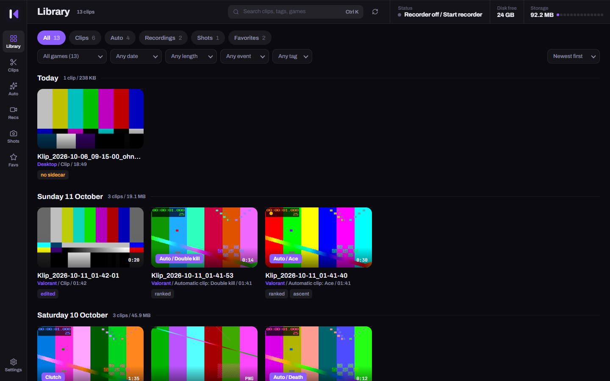
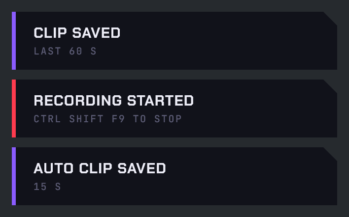
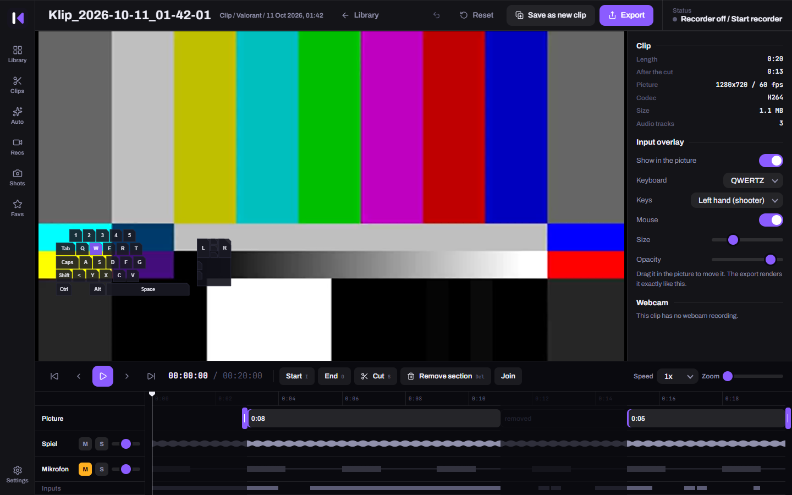
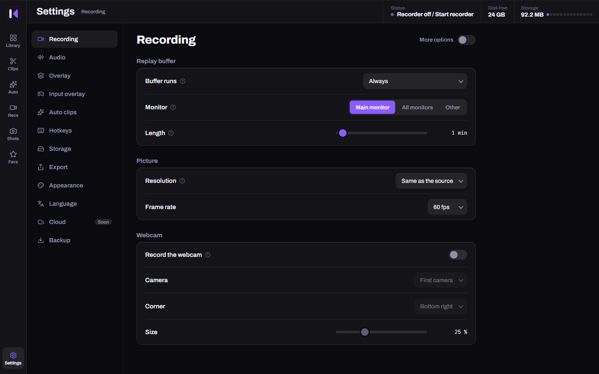
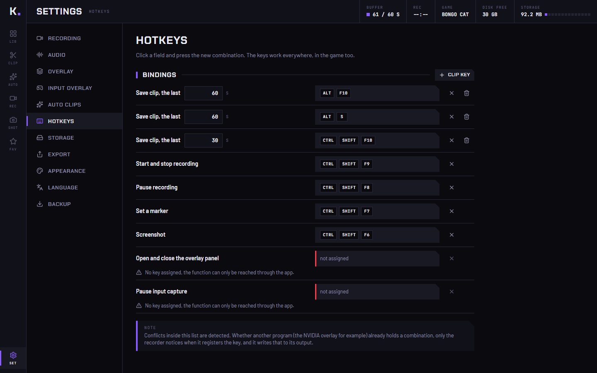
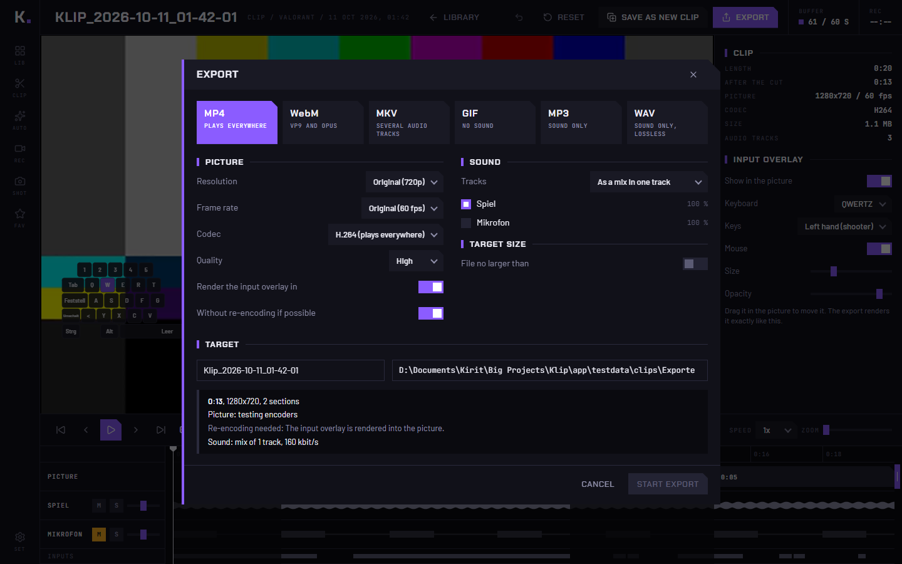
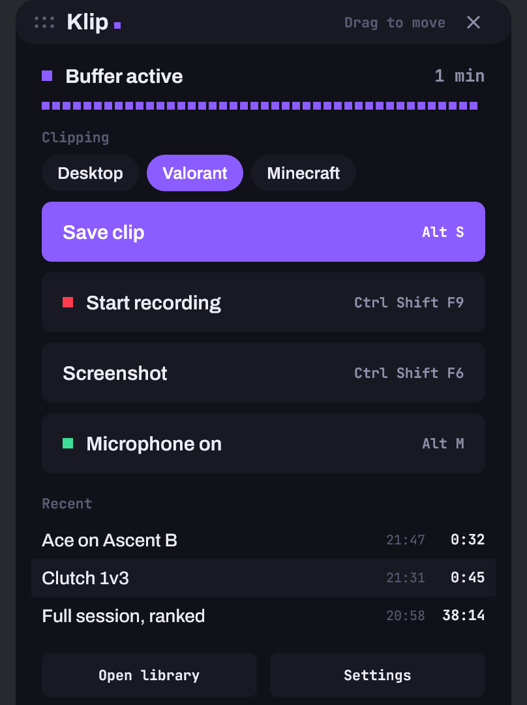

<div align="center">

# Klip.

**Clip the last minute. Decide what was in it afterwards.**

A clipping and recording tool for Windows 10 and 11. A small native recorder sits in the
tray and buffers your game on the GPU, a separate app holds the library and the editor.
Every audio source lands on its own track, so you choose later what ends up in the export.
No account needed, no telemetry. An optional cloud on your own server is coming soon.

[](#install)
[](#why)
[](#what-works-today)



</div>

---

## Why?

I wanted the recorder of NVIDIA ShadowPlay and the library and editor of Medal in one tool,
with every setting open and without an account. And I never wanted to decide *while playing*
whether Discord or music belongs in a clip.

So Klip records everything separately and burns nothing in. Game, microphone, voice chat,
music and browser are separate tracks in one file. Pressed keys are a data track next to the
video. What a clip sounds and looks like is decided in the editor, the original stays untouched.

One rule shaped the rest: **Klip never touches the game.** It captures the screen from
outside, reads no game memory and loads nothing into a game process. I play Valorant, and a
ban caused by my own clip tool would be the worst possible outcome.

## Getting started

There is no release download yet, you build Klip yourself. That takes a few minutes, see
[Install](#install).

1. **Open Klip.** The app starts the recorder, and a dot appears in the tray next to the
   clock. Green means the buffer runs, red means a recording runs.

2. **Play, or do anything else.** The buffer runs all the time on your main monitor, on the
   desktop too. Klip finds your games through your Steam, Epic and Riot libraries and files
   their clips under the name of the game. If you want nothing of your desktop in the
   buffer, switch to "only while a game is recognised".

3. **Press `Alt+S` or `Alt+F10`.** The last 60 seconds are written to `Klip\<Game>` in your
   video folder in a fraction of a second, because nothing is encoded again. A short notice
   in the top right and a quiet sound confirm it.

   

4. **Open the library** from the tray menu and click the clip. Trim it with `I` and `O`, mute
   single tracks, switch the key overlay on, and export.

   

5. **Optional:** press `Ctrl+Shift+F5` for the overlay panel on top of the game.

## Features

### Record

- **Replay buffer.** Keeps the last seconds as encoded video in RAM, or in segment files on
  disk for long buffers. Default 60 seconds.
- **Hardware encoding.** Uses the encoder that ships with the graphics driver (H.264, HEVC,
  AV1). Frames stay on the GPU from capture to encoder, including downscaling.
- **Manual recording** with pause and markers. Written as fragmented MP4, so a crash leaves a
  playable file. Stops by itself below 2 GB of free disk space.
- **Screenshots** as PNG.
- **Sources.** The main monitor by default, both monitors side by side in one picture with
  one click, or a chosen monitor, or the monitor of the game. A region of the picture is possible too.
- **Clip anywhere.** The buffer runs on the desktop as well. "Only while a game is
  recognised" is one switch away.
- **Pick the source in the overlay.** The panel shows what Klip clips for right now, the
  desktop or a game, and switches to any other running game with one click. Clips land in
  that game's folder.
- **Webcam.** Recorded as a file of its own next to each clip. In the editor you choose the
  corner and the size, or leave it out, and the export lays it over the picture.

### Separate everything

- **One audio track per source, found by itself.** Mix, system, microphone and game are
  always there. Every other program that plays sound gets a track of its own the moment it
  becomes audible, up to 16 tracks, as AAC in the same MP4. Switch to "only selected
  programs" if you want a fixed list. Track 1 is the mix, so players that only know one
  track play the right thing.
- **Input track.** Key and mouse button states are stored as `<clip>.inputs.json` next to the
  video, not burned into the picture. Only while a recognised game has the focus, and only
  the keys of the chosen layout. Nothing else is ever stored. The keys are not shown while
  you play, only in the clip, top right by default.

### Find and edit

- **Library** grouped by day, with search and filters for kind, event, length and tags, and
  a dropdown with every game you have clips of, plus "Desktop". Every card names its game.
  Favourites, rename, tags, delete to the recycle bin.
- **Editor.** Trim, cut into segments, delete segments, mute or solo each audio track, show
  the input overlay in the picture. Edits live in `<clip>.edit.json`, the original stays.
- **Export** as MP4, WebM, MKV, GIF, MP3 or WAV, with a target size ("fits into 10 MB").
  A clip that was only trimmed is exported without re-encoding.

### Automate

- **Auto clips for Valorant.** A detector looks at small cut outs of the captured picture
  (kill feed, round banner) ten times a second and saves a clip around kills, deaths and
  round ends. In the library such a clip is marked "Automatic clip" together with the
  reason, for example "Ace".
- **Tray, autostart, single instance.**
- **Says what went wrong.** A clip that could not be saved, or a hotkey another program
  holds, shows as a red notice instead of doing nothing.
- **Overlay** as a window of its own on top of the game: a notice in the top right for
  every clip, auto clip and recording, and a panel you can drag anywhere with buttons for
  the main actions. It is excluded from the recording.
- **A sound for every event,** and your own if you want: a WAV file named `clip.wav`,
  `auto.wav`, `rec_start.wav`, `rec_stop.wav`, `shot.wav` or `tick.wav` in
  `%APPDATA%\Klip\sounds` replaces the built in one. The settings have a row per sound to listen and
  to pick a file.
- **English and German.** English by default, switchable in the settings.

## Screens

| | |
|---|---|
| **Library** with filters and storage meter | **Editor** with tracks and input overlay |
|  |  |
| **Recording settings** | **Hotkeys** with conflict detection |
|  |  |
| **Export settings** | **Overlay elements** |
|  |  |

The app screenshots show the running interface with generated test clips. The overlay
pictures are rendered by the overlay's own drawing code into an image: the real overlay
window is invisible to screen capture on purpose.

## Hotkeys

Defaults, all changeable in the settings. Klip tells you when a combination is taken by
another program.

| Keys | Action |
|---|---|
| `Alt+F10` or `Alt+S` | Save the last 60 seconds |
| `Ctrl+Shift+F10` | Save the last 30 seconds |
| `Ctrl+Shift+F9` | Start or stop a recording |
| `Ctrl+Shift+F8` | Pause or resume the recording |
| `Ctrl+Shift+F7` | Set a marker in the recording |
| `Ctrl+Shift+F6` | Screenshot |
| `Ctrl+Shift+F5` | Open or close the overlay panel |
| `Ctrl+Shift+F4` | Pause or resume the capture of keys |

In the editor: `Space` play, `J` `K` `L` shuttle, `I` and `O` set start and end, `S` cut,
`Del` delete the segment.

## Anti-cheat

Klip is built for games with kernel anti-cheat and treats every unknown game as protected.

| Klip does | Klip never does |
|---|---|
| Capture the screen with Windows Graphics Capture | Read game memory |
| Read audio from the Windows audio engine | Load code into a game process |
| Register its own hotkeys with `RegisterHotKey` | Install hooks that inject into other programs |
| Read key states through Raw Input | Generate input |
| Draw the overlay in its own window | Talk to the Riot client or its local API |

Detected events are never shown during a match. The only visible effect of a detected kill
is the notice that a clip was saved. No anti-cheat vendor has reviewed or approved Klip.

## What works today

Klip is an early build by one person. This is the honest state.

**Tested:** capture, encoding in all three codecs, buffer in RAM and on disk, clips,
recordings, screenshots, seven audio tracks with a test tone, tray, game library scan,
the pipe between app and recorder, the library, the editor, every export format listed
except MKV and WAV, the setup program, the overlay window on a second monitor.

**Built, but not yet tried in a real game:** starting and stopping the buffer by a game,
real hotkey presses, the overlay on top of a fullscreen game, dragging and clicking the panel
with a real mouse, changing the clip folder while the recorder runs, auto clips on live
Valorant picture, a real webcam (the camera path is tested with a video file standing in
for one, because no camera was connected). The Valorant detector found all six events in three real clips, which is far too
little footage to call a hit rate. Multi kills are only tested with synthetic input.

**Missing:** software encoding as a fallback, a way to edit per game profiles, the layout
editor for the input overlay, clutch, spike and match end detection, more games, auto clips
while all monitors are recorded. A program that starts to play sound during a manual
recording gets no track of its own in that recording, only in the mix.

Measured on an RTX 5060 and an i7-8700 at 1080p: 0.0 to 0.1 % CPU at idle without audio,
about 1.5 % with all default audio tracks, 2.3 to 2.9 % with audio, detection, input capture
and a running recording. The effect on the frame rate of a game has not been measured yet.

## Klip Cloud (coming soon)

Signing in works already: under **Settings, Cloud** you sign in with Discord and Klip shows
your name and picture. Uploading opens soon. Then Klip puts your clips on the Klip Cloud
server, and on your phone you open the same address, sign in with the same Discord account
and see every clip, playable and downloadable. There is no phone app, the page works in any
mobile browser.

- **What goes up:** nothing, only clips you pick (right click, "Upload to Klip Cloud"), or
  every new clip automatically.
- **Where it stays:** on the PC and in the cloud, or only in the cloud. With "only in the
  cloud" the local file goes to the recycle bin after a confirmed upload, never deleted for good.
- **Where the cloud keeps it:** on the disk of the server, or in your Google Drive. With Drive
  the server only sees the files Klip created there (`drive.file` scope), nothing else.
- **Sign in:** the PC gets a short code to confirm in the browser, the token is stored
  encrypted for your Windows user (DPAPI). Klip never sees your Discord password.

The server is in [`cloud/`](cloud/README.md): Node 22, no dependencies, one SQLite file.

## How data is stored

```
<your video folder>\Klip\
├─ Valorant\
│  ├─ Klip_2026-10-11_01-43-25_kill.mp4        video with all audio tracks
│  ├─ Klip_2026-10-11_01-43-25_kill.klip.json  game, kind, events, track names, tags
│  ├─ Klip_2026-10-11_01-43-25_kill.inputs.json  key and mouse button states
│  └─ Klip_2026-10-11_01-43-25_kill.edit.json  your cuts, written by the editor
└─ Exporte\                                   exports, hidden in the library

%APPDATA%\Klip\
├─ config.json     recorder settings
├─ app.json        app settings
├─ cloud.json      Klip Cloud sign in, encrypted for your Windows user
└─ sounds\         optional, your own notice sounds
```

The files next to a clip are the truth, there is no database. Move, copy or delete clips in
Explorer and the library follows.

## Install

Build it from source. You need Rust (MSVC toolchain), Node.js and the WebView2 runtime, which
Windows 11 already has.

```powershell
cd app
npm install
cd ..
powershell -ExecutionPolicy Bypass -File scripts\stage.ps1
```

This builds the recorder and the app and packs them into `target\release\klip-setup.exe`.
The setup installs per user into `%LOCALAPPDATA%\Programs\Klip`, without admin rights, and
removes everything again through "Installed apps". Settings and clips stay.

**FFmpeg is not included.** Thumbnails, audio in the editor and export need `ffmpeg.exe`.
Set its path in the app settings, the default is `C:\ffmpeg\bin\ffmpeg.exe`.

## Development

```powershell
cargo build --release -p klip-recorder    # the recorder
cargo test --workspace                    # tests of all crates
target\release\klip-recorder.exe --list   # monitors and windows it can capture
target\release\klip-recorder.exe --test 14 --clip 8 --out <empty folder>
                                          # walks through every action once and exits

cd app
npm run dev                               # frontend in the browser
npm test                                  # frontend tests
npm run tauri dev                         # the app
```

The recorder is plain Rust on the `windows` crate without a UI framework. `recorder/` wires
six crates together: `klip-core` (settings and file formats), `klip-games` (library scan,
protected games, watcher), `klip-tray`, `klip-input` (Raw Input and the input track),
`klip-overlay` (DirectComposition and Direct2D) and `klip-detect` (event detection). The app
under `app/` is Tauri 2 with React and talks to the recorder through a local named pipe.
`installer/` is the setup program.

## Credits and license

The notice sounds come from the "Interface Sounds" pack by [Kenney](https://www.kenney.nl),
licensed CC0. The fonts Archivo and JetBrains Mono are bundled under the SIL Open Font
License.

Klip has no license yet. Until one is added, the code is published to read and to build for
yourself, all rights reserved.
